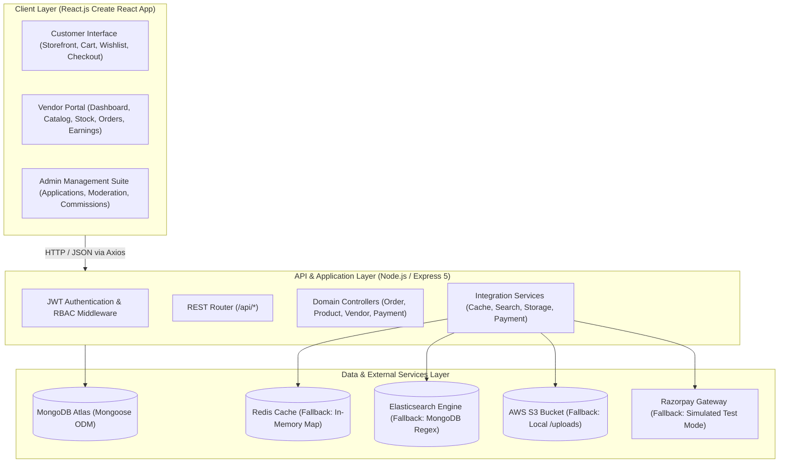
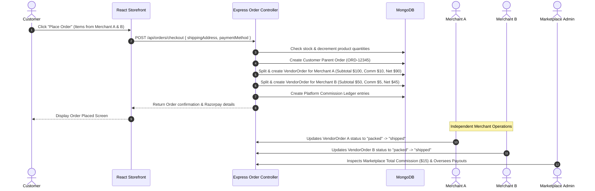

# Vendora Multi-Vendor E-Commerce Marketplace – Technical Architecture

Vendora is built with a resilient, decoupled MERN architecture designed to handle multi-seller fulfillment, real-time search indexing, caching, and payment processing with local development fallbacks.

---

## 1. High-Level System Architecture

---

## 2. Multi-Vendor Order Lifecycle & Split Sub-Order Architecture

One of the foundational design requirements of Vendora is seamless multi-vendor order handling. When a customer purchases items from multiple distinct merchants in a single checkout session:

1. **Validation & Atomic Stock Reservation**: The backend verifies stock for each line item. If all are available, it decrements product stock immediately to prevent race conditions and overselling.
2. **Customer Parent Order Creation**: Creates a single customer-facing `Order` document referencing the buyer, combined items, aggregate total, and shipping address.
3. **Vendor-Specific Sub-Orders (`VendorOrder`)**: Groups line items by `vendorId`. For each merchant, creates an isolated `VendorOrder` sub-order with:
   - Scoped line items belonging only to that vendor.
   - Calculated vendor subtotal.
   - Platform commission deduction (based on vendor's agreed percentage).
   - Net vendor payout ledger entry.
   - Independent fulfillment status tracking (`placed` -> `packed` -> `shipped` -> `delivered`).
4. **Commission Audit Record**: Creates a `Commission` record per vendor slice to ensure accurate ledger balancing for the admin.
5. **Cart Invalidation**: Clears the customer's cached cart from Redis and MongoDB.

### Multi-Vendor Checkout Sequence Diagram

---

## 3. Graceful Integration & Fallback Strategies

To ensure the application remains 100% operational in disconnected, local development, or sandbox environments without crashing when external cloud services are offline, Vendora uses a pluggable service fallback pattern:

| Service | Primary Integration | Fallback Mechanism | Telemetry Indication |
|---|---|---|---|
| **Caching** | Redis (`ioredis` connection) | In-Memory JavaScript `Map` with TTL expiry | `GET /api/health` reports status |
| **Search** | Elasticsearch (`@elastic/elasticsearch`) | MongoDB weighted text index & regex query | Search response includes `source: "mongodb"` |
| **Media Storage** | AWS S3 SDK (`@aws-sdk/client-s3`) | Local disk `/uploads` static file serving | File URL starts with `/uploads/...` |
| **Payments** | Razorpay Test Gateway | Simulated test mode signature verification | Allows instant verification with test signatures |

### 3.1 Redis Caching Service
- **Cached Entities**: Customer active cart (`cart:<userId>`), category trees, and frequently accessed storefront products.
- **Cache Invalidation**: On cart modification (`add`, `update`, `remove`), cache key is deleted or rewritten. On checkout completion, cart key is purged immediately.
- **Fault-Tolerance**: If Redis disconnects, the cache service catches the error, activates an in-memory Map, logs a warning once, and continues serving requests without disrupting user transactions.

### 3.2 Elasticsearch Engine
- **Product Indexing**: When an approved vendor adds or updates a product, `indexProduct()` pushes title, brand, category, description, and price to Elasticsearch index `products`.
- **Search Query Builder**: Combines multi-match fuzzy search on title and description with boolean filter clauses for category, price bounds, and active status.
- **Fallback Switch**: If Elasticsearch host is unreachable, `searchWithElasticsearch()` seamlessly falls back to MongoDB `$text` search and `$regex` queries, ensuring zero disruption to customer search experiences.

---

## 4. Payment Processing & Marketplace Settlement Architecture

Vendora strictly separates **Payment Collection** from **Vendor Settlement**:

1. **Payment Collection**:
   - The customer pays Vendora (the marketplace entity) for the entire cart amount through Razorpay.
   - Backend creates a Razorpay Order (`/api/payments/create-order`).
   - Frontend launches the Razorpay Checkout popup.
   - On payment completion, frontend sends Razorpay payment credentials to `/api/payments/verify`.
   - Backend performs cryptographic verification (`crypto.createHmac('sha256', secret)`) to ensure the signature is authentic before marking the parent order as `paid`.
   - Asynchronous reconciliation is supported via `/api/payments/webhook`.

2. **Vendor Settlement (Escrow / Payout Ledger)**:
   - Vendors do NOT directly receive raw payment callbacks from customers.
   - Net vendor earnings are calculated per line item and recorded in the `Commission` and `VendorOrder` schemas.
   - When orders transition to `delivered` and the return window passes, platform admins initiate payouts recorded in `Payout` schema to the vendor's registered bank account.

---

## 5. Security & Authorization Architecture

### 5.1 Role-Based Access Control (RBAC) Matrix

| Endpoint Group | Customer | Vendor (Pending) | Vendor (Approved) | Admin |
|---|---|---|---|---|
| `/api/auth/profile`, `/api/auth/addresses` | Allowed | Allowed | Allowed | Allowed |
| `/api/cart/*`, `/api/wishlist/*` | Allowed | Allowed | Allowed | Allowed |
| `/api/orders/checkout`, `/api/orders/my-orders` | Allowed | Allowed | Allowed | Allowed |
| `/api/vendor/apply`, `/api/vendor/status` | Allowed | Allowed | Allowed | Allowed |
| `/api/vendor/profile`, `/api/vendor/dashboard/*` | Denied | Denied | Allowed | Allowed |
| `/api/products` (POST / PUT / DELETE) | Denied | Denied | Allowed (Own products only) | Allowed |
| `/api/admin/*` (Vendor approvals, moderation) | Denied | Denied | Denied | Allowed |

### 5.2 Security Measures
- **Password Protection**: Passwords hashed with `bcryptjs` using a minimum work factor of 10 rounds; never stored in plaintext.
- **JWT Authentication**: Stateless Bearer tokens signed with HMAC-SHA256, carrying user ID, role, and approval status, with 7-day expiration.
- **Strict Vendor Scoping**: In `productController.js` and `orderController.js`, queries strictly check `vendorId: vendor._id` to ensure one vendor cannot view, modify, or manipulate products or earnings belonging to another vendor.
- **Input Sanitization**: Express JSON body parsers, URL parameter validators, and MongoDB schema type casting protect against NoSQL injection and malformed requests.
