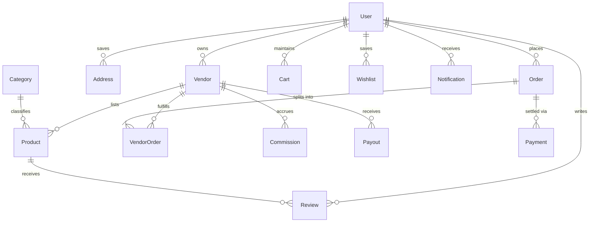

# Vendora Multi-Vendor E-Commerce Marketplace – Database Schema Reference

This document provides complete architectural specifications, entity relationships, and field definitions for all 15 Mongoose schemas utilized across Vendora.

---

## 1. Entity Relationship Diagram

---

## 2. Models Specification

### 2.1 User (`models/User.js`)
Stores authentication, credential hashes, profile details, and role assignments.

| Field | Type | Required | Constraints / Default | Description |
|---|---|---|---|---|
| `_id` | `ObjectId` | Auto | Unique primary key | MongoDB internal ID |
| `name` | `String` | Yes | Trimmed, min 2 chars | Full name of the user |
| `email` | `String` | Yes | Unique, lowercase, indexed | Unique email address |
| `password` | `String` | Yes | Min 8 chars (bcrypt hash) | Encrypted password |
| `role` | `String` | Yes | Enum: `['customer', 'vendor', 'admin']`, default `'customer'` | Authorization role |
| `phone` | `String` | No | Optional phone number | Contact number |
| `avatar` | `String` | No | Default avatar URL | Profile image |
| `isApproved` | `Boolean` | No | Default: `true` (for customers), `false` (for vendors) | Marketplace approval status |
| `isActive` | `Boolean` | No | Default: `true` | Account active flag |
| `address` | `Embedded` | No | `street`, `city`, `state`, `postalCode`, `country` | Primary delivery address |
| `createdAt` / `updatedAt` | `Date` | Auto | Managed by Mongoose | Timestamps |

**Indexes**:
- `{ email: 1 }` (Unique)
- `{ role: 1 }`

---

### 2.2 Vendor (`models/Vendor.js`)
Maintains seller business profiles, vetting state, commission agreements, and payout banking info.

| Field | Type | Required | Constraints / Default | Description |
|---|---|---|---|---|
| `_id` | `ObjectId` | Auto | Unique primary key | MongoDB internal ID |
| `userId` | `ObjectId` | Yes | Ref: `User`, Unique | Foreign key linking user account |
| `storeName` | `String` | Yes | Trimmed, unique | Display brand name |
| `description` | `String` | Yes | Trimmed | Store mission & biography |
| `phone` | `String` | Yes | Validated string | Merchant contact phone |
| `address` | `String` | Yes | Physical merchant address | Registered office/warehouse |
| `status` | `String` | Yes | Enum: `['pending', 'approved', 'rejected', 'suspended']`, default `'pending'` | Vetting lifecycle status |
| `commissionRate` | `Number` | Yes | Default: `10` (range: 0-100) | Platform fee percentage |
| `logo` | `String` | No | URL string | Merchant brand logo |
| `banner` | `String` | No | URL string | Storefront billboard banner |
| `bankDetails` | `Embedded` | No | `accountHolderName`, `accountNumber`, `bankName`, `routingNumber` | Banking disbursement info |
| `rejectionReason` | `String` | No | Populated if rejected | Feedback for vendor applicant |

**Indexes**:
- `{ userId: 1 }` (Unique)
- `{ status: 1 }`
- `{ storeName: "text" }`

---

### 2.3 Product (`models/Product.js`)
Represents marketplace items listed by approved merchants.

| Field | Type | Required | Constraints / Default | Description |
|---|---|---|---|---|
| `_id` | `ObjectId` | Auto | Unique primary key | MongoDB internal ID |
| `vendorId` | `ObjectId` | Yes | Ref: `Vendor`, Indexed | Owner merchant store |
| `name` | `String` | Yes | Min 3 chars | Product title |
| `sku` | `String` | No | Indexed | Stock Keeping Unit |
| `description` | `String` | Yes | Min 10 chars | Detailed markdown/prose description |
| `category` | `String` | Yes | Matches Category name | Classification category |
| `brand` | `String` | Yes | Trimmed | Brand label |
| `price` | `Number` | Yes | Min: 0 | Selling unit price |
| `stock` | `Number` | Yes | Min: 0 | Current inventory quantity |
| `images` | `Array[String]`| Yes | Array of image URLs / paths | Product gallery images |
| `rating` | `Number` | No | Default: `0`, range 0-5 | Aggregated customer rating |
| `numReviews` | `Number` | No | Default: `0` | Number of verified customer reviews |
| `isActive` | `Boolean` | No | Default: `true` | Visibility flag |

**Indexes**:
- `{ name: "text", description: "text", brand: "text" }` (Compound full-text index)
- `{ category: 1, price: 1 }`
- `{ vendorId: 1, isActive: 1 }`

---

### 2.4 Category (`models/Category.js`)
Classification hierarchy for dynamic browsing and homepage filtering.

| Field | Type | Required | Constraints / Default | Description |
|---|---|---|---|---|
| `_id` | `ObjectId` | Auto | Unique primary key | MongoDB internal ID |
| `name` | `String` | Yes | Unique, trimmed | Category display title |
| `slug` | `String` | Yes | Unique, lowercase, indexed | URL-friendly slug |
| `description` | `String` | No | Trimmed | Category overview |
| `image` | `String` | No | URL string | Category banner / thumbnail |
| `icon` | `String` | No | Default `'Package'` | Lucide icon identifier |
| `displayOrder` | `Number` | No | Default `0` | Sorting order for navigation |
| `isActive` | `Boolean` | No | Default `true` | Active status |

---

### 2.5 Cart (`models/Cart.js`)
Customer multi-vendor shopping cart with coupon deductions.

| Field | Type | Required | Constraints / Default | Description |
|---|---|---|---|---|
| `_id` | `ObjectId` | Auto | Unique primary key | MongoDB internal ID |
| `userId` | `ObjectId` | Yes | Ref: `User`, Unique | Owner customer ID |
| `items` | `Array[Object]`| Yes | Subdocuments | Cart line items |
| `items[].productId` | `ObjectId` | Yes | Ref: `Product` | Targeted product item |
| `items[].quantity` | `Number` | Yes | Min: 1 | Ordered count |
| `items[].price` | `Number` | Yes | Snapshot price | Unit price at time of adding |
| `coupon` | `Embedded` | No | `code`, `discountPercentage`, `maxDiscount` | Applied promo discount |
| `updatedAt` | `Date` | Auto | Timestamp | Last modified date |

---

### 2.6 Wishlist (`models/Wishlist.js`)
Customer bookmarked products list.

| Field | Type | Required | Constraints / Default | Description |
|---|---|---|---|---|
| `_id` | `ObjectId` | Auto | Unique primary key | MongoDB internal ID |
| `userId` | `ObjectId` | Yes | Ref: `User`, Unique | Customer owner ID |
| `products` | `Array[ObjectId]`| Yes | Ref: `Product` | Array of saved product IDs |

---

### 2.7 Address (`models/Address.js`)
Customer address book for shipping destinations.

| Field | Type | Required | Constraints / Default | Description |
|---|---|---|---|---|
| `_id` | `ObjectId` | Auto | Unique primary key | MongoDB internal ID |
| `userId` | `ObjectId` | Yes | Ref: `User`, Indexed | Owner customer ID |
| `fullName` | `String` | Yes | Trimmed | Recipient name |
| `phone` | `String` | Yes | Contact phone | Recipient contact |
| `street` | `String` | Yes | Street address | Physical address line |
| `city` | `String` | Yes | City name | Destination city |
| `state` | `String` | Yes | State/Province | Destination state |
| `postalCode` | `String` | Yes | Zip/Postal code | Routing postal code |
| `country` | `String` | Yes | Default `'United States'` | Destination country |
| `isDefault` | `Boolean` | No | Default `false` | Default shipping flag |
| `type` | `String` | No | Enum: `['home', 'office', 'other']` | Address classification |

---

### 2.8 Order (`models/Order.js`)
Customer-facing parent transaction document across multiple vendors.

| Field | Type | Required | Constraints / Default | Description |
|---|---|---|---|---|
| `_id` | `ObjectId` | Auto | Unique primary key | MongoDB internal ID |
| `userId` | `ObjectId` | Yes | Ref: `User`, Indexed | Purchasing customer ID |
| `orderNumber` | `String` | Yes | Unique | Human-readable ID (e.g. `ORD-20261115-001`) |
| `items` | `Array[Object]`| Yes | Array of purchased items | Multi-vendor snapshot items |
| `items[].productId` | `ObjectId` | Yes | Ref: `Product` | Product item |
| `items[].vendorId` | `ObjectId` | Yes | Ref: `Vendor` | Fulfilling merchant |
| `items[].price` | `Number` | Yes | Item unit price | Purchased price |
| `items[].quantity` | `Number` | Yes | Quantity purchased | Item count |
| `items[].commissionRate`| `Number` | Yes | Merchant rate snapshot | Rate % at checkout |
| `items[].commissionAmount`| `Number` | Yes | Computed commission | Fee earned by Vendora |
| `items[].vendorPayout` | `Number` | Yes | Net vendor balance | Earnings credited |
| `totalAmount` | `Number` | Yes | Final payable amount | Grand total |
| `shippingAddress` | `Embedded` | Yes | Recipient shipping details | Destination info |
| `paymentStatus` | `String` | Yes | Enum: `['pending', 'paid', 'failed']` | Payment state |
| `orderStatus` | `String` | Yes | Enum: `['placed', 'processing', 'completed', 'cancelled']` | Parent lifecycle status |
| `paymentMethod` | `String` | Yes | Enum: `['razorpay', 'cod']` | Gateway mechanism |

---

### 2.9 VendorOrder (`models/VendorOrder.js`)
Merchant-isolated sub-order for independent fulfillment and tracking.

| Field | Type | Required | Constraints / Default | Description |
|---|---|---|---|---|
| `_id` | `ObjectId` | Auto | Unique primary key | MongoDB internal ID |
| `orderId` | `ObjectId` | Yes | Ref: `Order`, Indexed | Parent transaction ID |
| `vendorId` | `ObjectId` | Yes | Ref: `Vendor`, Indexed | Targeted vendor |
| `customerId` | `ObjectId` | Yes | Ref: `User` | Customer ID |
| `items` | `Array[Object]`| Yes | Scoped items | Only this vendor's items |
| `subtotal` | `Number` | Yes | Sum of line prices | Gross vendor items amount |
| `platformCommission` | `Number` | Yes | Subtotal * rate % | Marketplace commission fee |
| `vendorEarnings` | `Number` | Yes | Subtotal - Commission | Net merchant revenue |
| `status` | `String` | Yes | Enum: `['placed', 'packed', 'shipped', 'delivered', 'cancelled']` | Vendor fulfillment stage |
| `trackingNumber` | `String` | No | Logistics carrier tracking code | Tracking string |
| `carrier` | `String` | No | e.g. FedEx, DHL, BlueDart | Logistics company |

---

### 2.10 Payment (`models/Payment.js`)
Payment audit ledger for Razorpay transactions and webhook receipts.

| Field | Type | Required | Constraints / Default | Description |
|---|---|---|---|---|
| `_id` | `ObjectId` | Auto | Unique primary key | MongoDB internal ID |
| `orderId` | `ObjectId` | Yes | Ref: `Order`, Indexed | Parent order ID |
| `userId` | `ObjectId` | Yes | Ref: `User` | Customer payer ID |
| `amount` | `Number` | Yes | Amount in INR/currency | Total transaction amount |
| `currency` | `String` | Yes | Default `'INR'` | Currency code |
| `gateway` | `String` | Yes | Enum: `['razorpay', 'cod']` | Payment processor |
| `razorpayOrderId` | `String` | No | Razorpay order reference | `order_*` ID |
| `razorpayPaymentId`| `String` | No | Razorpay payment reference | `pay_*` ID |
| `razorpaySignature`| `String` | No | HMAC-SHA256 signature | Verification proof |
| `status` | `String` | Yes | Enum: `['pending', 'captured', 'failed', 'refunded']` | Transaction status |

---

### 2.11 Commission (`models/Commission.js`)
Platform revenue ledger tracking fees deducted per vendor sub-order.

| Field | Type | Required | Constraints / Default | Description |
|---|---|---|---|---|
| `_id` | `ObjectId` | Auto | Unique primary key | MongoDB internal ID |
| `orderId` | `ObjectId` | Yes | Ref: `Order` | Associated transaction |
| `vendorId` | `ObjectId` | Yes | Ref: `Vendor`, Indexed | Vendor source |
| `subtotal` | `Number` | Yes | Gross amount | Vendor subtotal |
| `commissionRate` | `Number` | Yes | Percentage | Applied commission rate |
| `commissionAmount`| `Number`| Yes | Fee | Platform earned revenue |
| `vendorPayout` | `Number` | Yes | Net | Net vendor share |
| `status` | `String` | Yes | Enum: `['pending', 'settled', 'refunded']` | Settlement state |

---

### 2.12 Payout (`models/Payout.js`)
Disbursement log tracking settlement of merchant balances to bank accounts.

| Field | Type | Required | Constraints / Default | Description |
|---|---|---|---|---|
| `_id` | `ObjectId` | Auto | Unique primary key | MongoDB internal ID |
| `vendorId` | `ObjectId` | Yes | Ref: `Vendor`, Indexed | Beneficiary merchant |
| `amount` | `Number` | Yes | Currency value | Payout disbursement sum |
| `bankDetails` | `Embedded` | Yes | Account, IFSC, routing | Bank destination details |
| `referenceNumber` | `String` | Yes | Bank wire/NEFT reference | Transaction reference ID |
| `status` | `String` | Yes | Enum: `['requested', 'processing', 'completed', 'failed']` | Disbursement status |
| `processedAt` | `Date` | No | Payout date | Execution timestamp |

---

### 2.13 Review (`models/Review.js`)
Customer rating and feedback on purchased items.

| Field | Type | Required | Constraints / Default | Description |
|---|---|---|---|---|
| `_id` | `ObjectId` | Auto | Unique primary key | MongoDB internal ID |
| `productId` | `ObjectId` | Yes | Ref: `Product`, Indexed | Reviewed product |
| `userId` | `ObjectId` | Yes | Ref: `User` | Reviewer customer |
| `rating` | `Number` | Yes | Min 1, Max 5 | 5-star rating |
| `comment` | `String` | Yes | Min 5 chars | Review commentary |
| `createdAt` | `Date` | Auto | Timestamp | Submission date |

---

### 2.14 Coupon (`models/Coupon.js`)
Marketplace discount codes and promotional vouchers.

| Field | Type | Required | Constraints / Default | Description |
|---|---|---|---|---|
| `_id` | `ObjectId` | Auto | Unique primary key | MongoDB internal ID |
| `code` | `String` | Yes | Unique, uppercase, trimmed | Coupon code (e.g. `WELCOME50`) |
| `discountPercentage`| `Number`| Yes | Range 1 - 100 | Percentage discount |
| `maxDiscount` | `Number` | Yes | Max monetary cap | Maximum discount amount |
| `expiryDate` | `Date` | Yes | Validity deadline | Expiration timestamp |
| `isActive` | `Boolean` | No | Default `true` | Active flag |

---

### 2.15 Notification (`models/Notification.js`)
In-app notification messages for customers and vendors.

| Field | Type | Required | Constraints / Default | Description |
|---|---|---|---|---|
| `_id` | `ObjectId` | Auto | Unique primary key | MongoDB internal ID |
| `recipientId` | `ObjectId` | Yes | Ref: `User`, Indexed | Recipient user ID |
| `title` | `String` | Yes | Trimmed | Notification heading |
| `message` | `String` | Yes | Trimmed | Notification content |
| `type` | `String` | Yes | Enum: `['order', 'vendor_approval', 'payout', 'system']` | Category |
| `isRead` | `Boolean` | No | Default `false` | Read receipt |
| `createdAt` | `Date` | Auto | Timestamp | Dispatch date |
