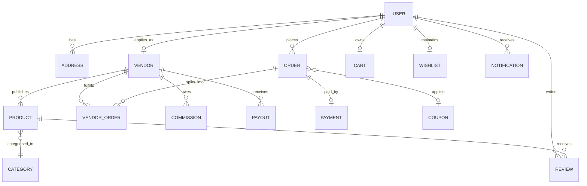

# Vendora - Development Plan & Architecture Blueprint

**Project Name:** Vendora – Multi-Vendor E-Commerce Marketplace  
**Tagline:** "One Marketplace. Multiple Sellers. Endless Possibilities."  
**Role:** Senior Full-Stack Software Architect, Senior MERN Stack Developer, UI/UX Designer, Database Engineer, DevOps Engineer  
**Date:** November 2026  
**Status:** In Progress (Systematic Execution across Phases 1 to 12)

---

## 1. Executive Summary & Existing Implementation Audit

### 1.1 Existing Architecture & Assets
An inspection of the workspace (`Vendora/`) reveals a structured MERN stack codebase with foundations for multi-tenant e-commerce:

- **Frontend (`Vendora/frontend`)**:
  - React 19 Single Page Application created with Create React App (preserving CRA setup as mandated).
  - React Router DOM v7 routing.
  - Bootstrap 5.3 + custom CSS styling and Lucide React icons.
  - React Context API for global `AuthContext` and `CartContext`.
  - Existing page templates: `Home.js`, `Products.js`, `ProductDetail.js`, `Cart.js`, `Checkout.js`, `OrderHistory.js`, `Login.js`, `Register.js`, `VendorOnboarding.js`, `VendorDashboard.js`, `AdminDashboard.js`, `NotFound.js`.
  - Responsive layout with `Navbar.js` and `Footer.js`.
  - Production build compiles cleanly with zero syntax errors.

- **Backend (`Vendora/backend`)**:
  - Express 5.3 on Node.js with REST API structure.
  - JWT authentication with bcryptjs password hashing and role-based middleware (`protect`, `authorize`, `approvedVendor`).
  - Mongoose 9 schemas for `User`, `Vendor`, `Product`, `Order`, `Cart`, `Review`, `Coupon`.
  - Micro-service adapters:
    - `elasticsearchService.js` (@elastic/elasticsearch client with fallback to MongoDB search).
    - `redisService.js` (ioredis client with memory-cache fallback).
    - `paymentService.js` (Razorpay client with simulated test mode order verification and multi-vendor split commission math).
    - `s3Service.js` (@aws-sdk/client-s3 with local disk storage fallback).
    - `invoiceService.js` (dynamic PDF streaming via PDFKit).
  - Existing automated test suite: `tests/api.test.js` passes all 12 tests.

---

## 2. Gap Analysis: Missing Features & Enhancements

Based on the project requirements, the following features are missing or need systematic completion:

| Area | Current State | Required Enhancement |
| :--- | :--- | :--- |
| **Database Models** | 7 models exist (`User`, `Vendor`, `Product`, `Order`, `Cart`, `Review`, `Coupon`) | Add 8 missing models: `Category`, `Wishlist`, `Address`, `VendorOrder` (sub-orders), `Payment` (transaction ledger), `Notification`, `Commission` (audit records), `Payout` |
| **Multi-Vendor Order Architecture** | Embedded item array in single `Order` document | Implement dual-level order processing: 1 parent Customer Order + independent `VendorOrder` documents for each merchant, item-level status updates, and commission records |
| **Wishlist Module** | Not implemented | Full Wishlist backend API (`/api/wishlist`) and frontend page (`/wishlist`) with toggle on cards & detail page |
| **Address Management** | Single address field on user | Dedicated `Address` model and API (`/api/addresses`) with multiple addresses and default selection |
| **Category System** | Hardcoded category strings | Dynamic `Category` model, admin category management, public category browser (`/categories`) |
| **Public Vendor Store** | Only private vendor dashboard | Public Vendor Storefront (`/store/:vendorId`) showcasing merchant branding, bio, rating, and product catalog |
| **Public Pages** | Basic pages only | Add dedicated `About.js` and `Contact.js` pages, plus category showcase |
| **Payment Webhook** | Basic signature verification | Dedicated `/api/payments/webhook` with HMAC SHA256 verification and `Payment` collection tracking |
| **Inventory Management** | Basic stock decrement on checkout | Inline stock updates, low-stock warning thresholds, SKU tracking, overselling prevention |
| **Vendor Settings** | Read-only profile view | Editable store details: store logo, store banner, description, phone, warehouse address, bank details |
| **Admin Moderation** | Basic approve/reject | Full vendor suspension/reactivation, product moderation (activate/deactivate/delete), category CRUD, commission rate control |

---

## 3. Database Architecture (Mongoose Models)

### Complete Collection Manifest (15 Models)
1. **User**: Name, email, hashed password, role (`customer`, `vendor`, `admin`), `isApproved`, `isActive`, phone, avatar.
2. **Vendor**: `userId`, storeName, description, phone, address, logo, banner, status (`pending`, `approved`, `rejected`, `suspended`), commissionRate (default 10%), bankDetails, reviewedAt.
3. **Product**: `vendorId`, name, description, category, brand, price, stock, sku, images, isActive, averageRating, totalReviews.
4. **Category**: Name, slug, description, image, isActive, productCount.
5. **Cart**: `userId`, items (`product`, quantity, price), coupon, totalAmount.
6. **Wishlist**: `userId`, products array (`[ObjectId]`).
7. **Address**: `userId`, fullName, phone, street, city, state, postalCode, country, isDefault.
8. **Order** (Customer Parent): `orderNumber`, `customer`, items, shippingAddress, totalItemsPrice, discountAmount, couponCode, totalAmount, platformCommissionTotal, paymentMethod, paymentStatus, orderStatus, trackingHistory.
9. **VendorOrder** (Merchant Sub-Order): `parentOrderId`, `orderNumber`, `vendorId`, `customer`, items, subtotal, commissionRate, commissionAmount, vendorPayout, status (`placed`, `packed`, `shipped`, `delivered`, `cancelled`), trackingHistory.
10. **Payment**: `orderId`, `customer`, amount, currency, paymentMethod, paymentStatus, razorpayOrderId, razorpayPaymentId, razorpaySignature, rawWebhookPayload.
11. **Review**: `userId`, `productId`, rating (1-5), title, comment, verifiedPurchase.
12. **Coupon**: code, discountPercent, maxDiscount, minOrderValue, expiryDate, usageLimit, usageCount, isActive.
13. **Notification**: `userId`, title, message, type (`order`, `vendor`, `system`), isRead, link.
14. **Commission**: `orderId`, `vendorId`, `productId`, itemPrice, quantity, commissionRate, commissionAmount, vendorPayout.
15. **Payout**: `vendorId`, amount, status (`pending`, `processed`, `failed`), paymentReference, periodStart, periodEnd.

---

## 4. API Architecture

### Authentication & User (`/api/auth`)
- `POST /api/auth/register` - Customer / Vendor registration
- `POST /api/auth/login` - JWT login
- `GET /api/auth/me` - Current authenticated user
- `PUT /api/auth/profile` - Update profile & contact
- `GET /api/auth/addresses` - List saved addresses
- `POST /api/auth/addresses` - Add new address
- `DELETE /api/auth/addresses/:id` - Delete saved address

### Vendor Management (`/api/vendor`)
- `POST /api/vendor/apply` - Submit vendor application
- `GET /api/vendor/application-status` - Check onboarding review status
- `GET /api/vendor/profile` - Current vendor profile
- `PUT /api/vendor/profile` - Update store settings (logo, banner, description, bank details)
- `GET /api/vendor/store/:vendorId` - Public vendor storefront & catalog
- `GET /api/vendor/products` - Vendor's own products
- `POST /api/vendor/products` - Add product
- `GET /api/vendor/products/:id` - Get product details
- `PUT /api/vendor/products/:id` - Edit product
- `DELETE /api/vendor/products/:id` - Delete product
- `PUT /api/vendor/products/:id/stock` - Direct stock update

### Public Catalog & Search (`/api/products`, `/api/categories`)
- `GET /api/products` - Search & filter catalog (Elasticsearch with MongoDB fallback)
- `GET /api/products/:id` - Product details & vendor details
- `GET /api/categories` - List active categories
- `POST /api/categories` - Admin create category
- `PUT /api/categories/:id` - Admin update category
- `DELETE /api/categories/:id` - Admin delete category

### Cart & Wishlist (`/api/cart`, `/api/wishlist`)
- `GET /api/cart` - Get user cart (Redis cached)
- `POST /api/cart/add` - Add item to cart
- `PUT /api/cart/item` - Update item quantity
- `DELETE /api/cart/item/:productId` - Remove item
- `DELETE /api/cart/clear` - Clear cart
- `POST /api/cart/apply-coupon` - Apply promo code
- `DELETE /api/cart/remove-coupon` - Remove promo code
- `GET /api/wishlist` - View user wishlist
- `POST /api/wishlist/toggle/:productId` - Add or remove wishlist item

### Multi-Vendor Orders & Payments (`/api/orders`, `/api/payments`)
- `POST /api/orders/checkout` - Create parent order + vendor sub-orders + Razorpay order
- `POST /api/orders/verify-payment` - Verify signature and update order status
- `GET /api/orders/my-orders` - Customer order history
- `GET /api/orders/:id` - Customer / Vendor / Admin single order view
- `GET /api/orders/:id/invoice` - Stream dynamic PDF tax invoice
- `PUT /api/orders/:id/cancel` - Customer cancel eligible order
- `GET /api/orders/vendor/orders` - Vendor's assigned sub-orders
- `PUT /api/orders/vendor/sub-orders/:id/status` - Vendor update sub-order status (`packed`, `shipped`, `delivered`)
- `POST /api/payments/create-order` - Create Razorpay transaction
- `POST /api/payments/verify` - Verify signature & log payment ledger
- `POST /api/payments/webhook` - Razorpay webhook signature verification

### Admin Governance (`/api/admin`)
- `GET /api/admin/analytics` - Platform GMV, commission totals, vendor payouts, category breakdown
- `GET /api/admin/applications` - Review pending/approved/rejected applications
- `PUT /api/admin/applications/:id/approve` - Approve vendor with custom commission %
- `PUT /api/admin/applications/:id/reject` - Reject vendor with reason
- `PUT /api/admin/vendors/:id/toggle-status` - Suspend / reactivate vendor
- `GET /api/admin/users` - List all users & customers
- `PUT /api/admin/users/:id/toggle-status` - Activate / deactivate user account
- `GET /api/admin/products` - Moderate all marketplace products
- `PUT /api/admin/products/:id/toggle-status` - Activate / deactivate product
- `DELETE /api/admin/products/:id` - Delete offending product
- `GET /api/admin/orders` - Comprehensive marketplace transactions
- `GET /api/admin/commissions` - Platform commission and vendor payout ledgers

### Reviews & Notifications (`/api/reviews`, `/api/notifications`)
- `GET /api/reviews/product/:productId` - Product reviews
- `POST /api/reviews` - Verified purchase review submission
- `DELETE /api/reviews/:id` - Admin review moderation
- `GET /api/notifications` - Get user notifications
- `PUT /api/notifications/:id/read` - Mark notification as read

---

## 5. Development Phases Roadmap

```mermaid
flowchart LR
    P1["Phase 1\nInspect & Audit"] --> P2["Phase 2\nBackend Architecture & Auth"]
    P2 --> P3["Phase 3\nVendor Application & Admin"]
    P3 --> P4["Phase 4\nProduct Catalog & S3"]
    P4 --> P5["Phase 5\nCustomer UI & Browsing"]
    P5 --> P6["Phase 6\nElasticsearch & Filters"]
    P6 --> P7["Phase 7\nCart, Wishlist & Redis"]
    P7 --> P8["Phase 8\nMulti-Vendor Orders"]
    P8 --> P9["Phase 9\nRazorpay & Payments"]
    P9 --> P10["Phase 10\nDashboards & Analytics"]
    P10 --> P11["Phase 11\nReviews & Notifications"]
    P11 --> P12["Phase 12\nSecurity, Tests & Docs"]
```

- **Phase 1: Project Inspection & Baseline Stabilization** (Completed)
  - Verified directory structure, package.json dependencies, and git history.
  - Tested backend test suite (12 passed) and frontend React build (zero errors).
  - Drafted comprehensive architecture blueprint and gap analysis.

- **Phase 2: Database Models & Authentication Architecture**
  - Implement all 15 Mongoose schemas with proper indexes and relationships.
  - Implement Address management API (`/api/auth/addresses`).

- **Phase 3: Vendor Onboarding & Store Settings**
  - Vendor store profile management (logo, banner, bank details).
  - Public Vendor Storefront API and frontend page (`/store/:vendorId`).
  - Admin vendor suspension / reactivation controls.

- **Phase 4: Product Catalog & Media Upload Pipeline**
  - SKU support, multiple image uploads via S3 with local disk fallback.
  - Dynamic `Category` model and category management.

- **Phase 5: Customer UI & Marketplace Browsing**
  - Categories page (`/categories`), About page (`/about`), Contact page (`/contact`).
  - Product Card enhancements with wishlist button and vendor badges.

- **Phase 6: Search & Filter Optimization**
  - Elasticsearch sync hooks with robust MongoDB search fallback.
  - Category, price range, brand, rating filters, and sorting.

- **Phase 7: High-Speed Cart, Wishlist & Redis Layer**
  - Dedicated Wishlist model and frontend page (`/wishlist`).
  - Redis cart caching with TTL and MongoDB fallback.

- **Phase 8: Multi-Vendor Order Processing & Inventory Control**
  - Dual-level order architecture: Customer parent Order + `VendorOrder` sub-orders.
  - Stock decrement with overselling prevention.
  - Order cancellation and inventory restoration for eligible orders.

- **Phase 9: Razorpay Payment Gateway & Transaction Ledger**
  - Test mode checkout, signature verification, and webhook handling.
  - `Payment` and `Commission` ledger models.

- **Phase 10: Vendor & Admin Dashboards Enhancement**
  - Vendor Dashboard: inventory management with inline stock updates, low-stock warnings, order fulfillment controls, earnings breakdown.
  - Admin Dashboard: category manager, vendor suspension toggle, user management, platform revenue analytics.

- **Phase 11: Customer Reviews, Ratings & Notifications**
  - Verified purchase badges, review star distribution, notification system.

- **Phase 12: Comprehensive Testing, Security Audit & Documentation**
  - Extended API test suite covering multi-vendor orders, wishlist, categories, and permissions.
  - Complete `API_DOCUMENTATION.md`, `DATABASE_SCHEMA.md`, `ARCHITECTURE.md`, `README.md`.

---

## 6. External Integrations & Development Fallback Strategy

| Integration | Primary Service | Development Fallback | Production Configuration Required |
| :--- | :--- | :--- | :--- |
| **Database** | MongoDB Atlas | Local MongoDB (`mongodb://127.0.0.1:27017/vendora`) | `MONGO_URI` connection string |
| **Cache** | Redis (`ioredis`) | High-speed in-memory JavaScript Map store | `REDIS_URL=redis://127.0.0.1:6379` |
| **Search** | Elasticsearch 8.x | MongoDB `$text` and regex weighted query engine | `ELASTICSEARCH_NODE=http://localhost:9200` |
| **Storage** | AWS S3 (`@aws-sdk/client-s3`) | Local disk directory (`backend/uploads/`) statically served | `AWS_ACCESS_KEY_ID`, `AWS_SECRET_ACCESS_KEY`, `AWS_S3_BUCKET`, `AWS_REGION` |
| **Payments** | Razorpay Test Gateway | Simulated test mode order creation and HMAC verification | `RAZORPAY_KEY_ID`, `RAZORPAY_KEY_SECRET` |

---

## 7. Testing Strategy

1. **Automated Unit & Integration Tests**:
   - In-process HTTP dispatch test suite in `backend/tests/api.test.js`.
   - Comprehensive test cases covering authentication, role boundaries, multi-vendor commission calculation, cart operations, wishlist, sub-orders, and payments.
2. **Frontend Component & Build Verification**:
   - `npm run build` with CRA react-scripts to guarantee zero compilation errors.
3. **End-to-End Persona Verification**:
   - Customer checkout flow with multi-vendor cart.
   - Vendor fulfillment lifecycle: placed -> packed -> shipped -> delivered.
   - Admin approval, commission rate setting, and platform analytics.
