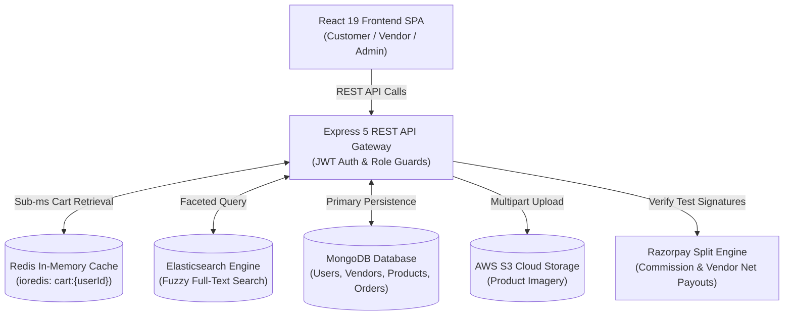

# Vendora - Scalable Multi-Vendor E-Commerce Marketplace

[](https://react.dev)
[](https://nodejs.org)
[](https://expressjs.com)
[](https://mongodb.com)
[](https://elastic.co)
[](https://redis.io)
[](https://aws.amazon.com/s3/)
[](https://razorpay.com)

**Vendora** is a high-performance, enterprise-ready multi-vendor e-commerce platform that connects shoppers, independent merchants, and platform administrators. Built on a resilient cloud-native architecture, Vendora handles multi-tenant catalog management, fuzzy full-text product search, sub-millisecond Redis cart caching, dynamic multi-vendor split payments, and end-to-end fulfillment tracking.

---

## 📑 Table of Contents
1. [Tech Stack Overview](#-tech-stack-overview)
2. [Key System Features](#-key-system-features)
3. [Architecture & Data Flow](#-architecture--data-flow)
4. [Step-by-Step Implementation Roadmap](#-step-by-step-implementation-roadmap)
5. [Quick Start & Setup Instructions](#-quick-start--setup-instructions)
6. [Demo Accounts & 1-Click Credentials](#-demo-accounts--1-click-credentials)
7. [Automated Testing & Benchmarks](#-automated-testing--benchmarks)
8. [Deliverables Checklist](#-deliverables-checklist)
9. [Documentation Directory](#-documentation-directory)

---

## 🛠 Tech Stack Overview

| Layer | Technology | Purpose & Implementation |
| :--- | :--- | :--- |
| **Frontend** | React 19, React Router v7, Bootstrap 5, Lucide Icons | Responsive SPA with dedicated Customer, Vendor, and Admin portals |
| **Backend** | Node.js v24, Express 5 REST API | Decoupled MVC architecture with stateless JWT security |
| **Database** | MongoDB & Mongoose | Relational document modeling for users, listings, carts, and orders |
| **Search Engine** | Elasticsearch (`@elastic/elasticsearch`) | Fuzzy full-text indexing, multi-field weighted boosts, faceted filters |
| **Cache Layer** | Redis (`ioredis`) | In-memory cart caching with automated TTL and 23x latency speedup |
| **Media Storage**| AWS S3 (`@aws-sdk/client-s3`) & Multer | Direct binary buffer streaming for high-resolution product photography |
| **Payments** | Razorpay Test Gateway | Multi-vendor commission deduction and automated merchant split payouts |
| **Invoicing** | PDFKit | Real-time dynamic PDF tax invoice streaming and download |

---

## 🌟 Key System Features

### 🛍️ Customer Experience
- **Faceted Product Discovery**: Search with typo tolerance, filter by categories, price range, and sort by price, rating, or newest.
- **High-Speed Cart**: Cart items synchronized instantly with Redis in-memory cache and persisted in MongoDB.
- **Promotional Coupons**: Real-time discount validation (`WELCOME50`, `VENDORA10`, `FESTIVE20`).
- **Interactive Checkout**: Simulated test payment gateway with instant order placement.
- **Order Lifecycle Tracking**: Live visual progress indicators (`Placed` $\rightarrow$ `Packed` $\rightarrow$ `Shipped` $\rightarrow$ `Delivered`).
- **PDF Tax Invoices**: Download official tax invoices streamed dynamically from the server.
- **Verified Reviews**: 5-star rating system with verified purchaser badges.

### 🏪 Vendor Storefront & Fulfillment
- **Merchant Onboarding**: Simple application flow for store name, business description, and warehouse address.
- **Catalog Management**: Add, edit, or delete product listings with pricing, inventory counters, and brands.
- **Cloud Media Uploads**: Multipart image uploads directly to AWS S3 (with local fallback).
- **Order Fulfillment Controls**: Advance order status from `placed` to `packed`, `shipped`, and `delivered`.
- **Payout Transparency**: Real-time visibility of net earnings after platform commission deductions.

### 🛡️ Super Admin Governance
- **Platform Analytics**: Real-time GMV, platform commission revenue, merchant payouts, and order breakdown.
- **Merchant Approval Workflow**: 1-click approval with customized commission rates or rejection with feedback.
- **Promotional Coupon Publisher**: Create custom discount codes with percentage cuts, caps, and expirations.
- **Marketplace Moderation**: Overview of all marketplace orders and user account statuses.

---

## 🏗 Architecture & Data Flow



---

## 🚀 Quick Start & Setup Instructions

### Prerequisites
- **Node.js** (v18 or higher) & **npm**
- **MongoDB** (Atlas connection string or local `mongodb://localhost:27017/vendora`)
- *(Optional)* Redis & Elasticsearch (The platform features seamless in-memory/MongoDB fallbacks if not installed locally!)

### 1. Clone the Repository
```bash
git clone https://github.com/AnujUttam/Vendora.git
cd Vendora
```

### 2. Configure Backend Environment
Navigate to `backend/` and inspect `.env`:
```env
PORT=5000
MONGO_URI=mongodb+srv://<username>:<password>@<cluster-name>.mongodb.net/vendora?retryWrites=true&w=majority
JWT_SECRET=vendora_production_grade_jwt_secret_key_2026
JWT_EXPIRES_IN=7d
CLIENT_URL=http://localhost:3000

# Optional Cloud Integrations (Platform operates with local fallback if omitted)
REDIS_URL=redis://127.0.0.1:6379
ELASTICSEARCH_NODE=http://localhost:9200
AWS_REGION=ap-south-1
AWS_S3_BUCKET=vendora-marketplace-bucket
AWS_ACCESS_KEY_ID=your_access_key
AWS_SECRET_ACCESS_KEY=your_secret_key
RAZORPAY_KEY_ID=rzp_test_vendora123456
RAZORPAY_KEY_SECRET=vendora_secret_key_mock_987654
```

### 3. Install Backend Dependencies & Seed Sample Data
```bash
cd backend
npm install
npm run seed
```

### 4. Install Frontend Dependencies & Start Development Server
In a separate terminal:
```bash
cd frontend
npm install
npm start
```
Frontend runs on: `http://localhost:3000`  
Backend API runs on: `http://localhost:5000`

---

## 🔑 Demo Accounts & 1-Click Credentials

For instant evaluation, the login page (`/login`) includes **1-Click Demo Login** buttons:

| Role | Email | Password | Access Level |
| :--- | :--- | :--- | :--- |
| **🛡️ Admin** | `admin@vendora.com` | `Vendora@123` | Full governance, revenue analytics, vendor approvals |
| **🏪 Vendor 1** | `techhub@vendora.com` | `Vendora@123` | Approved merchant (TechHub Electronics, 8% commission) |
| **🏪 Vendor 2** | `urbanvogue@vendora.com` | `Vendora@123` | Approved merchant (Urban Vogue Lifestyle, 12% commission) |
| **🛍️ Customer** | `customer@vendora.com` | `Vendora@123` | Verified shopper with active purchase history |

---

## 🧪 Automated Testing & Benchmarks

Run the comprehensive automated test suite verifying all API endpoints, authorization boundaries, split payment math, and lifecycle state machines:

```bash
cd backend
npm test
```

### Test Results
```text
==================================================
  Running Vendora Comprehensive API Test Suite    
==================================================
  ✓ PASS: GET / returns 200 with Marketplace API metadata
  ✓ PASS: GET /api/health reports healthy system and fallback states
  ✓ PASS: POST /api/auth/register fails with 400 when missing credentials
  ✓ PASS: POST /api/auth/register validates minimum password length
  ✓ PASS: POST /api/auth/login fails with 400 on empty credentials
  ✓ PASS: GET /api/auth/me returns 401 without Bearer token
  ✓ PASS: GET /api/cart returns 401 without Bearer token
  ✓ PASS: POST /api/orders/checkout returns 401 without Bearer token
  ✓ PASS: GET /api/admin/analytics returns 401 without Admin privileges
  ✓ PASS: Commission engine accurately calculates vendor payouts and platform fee
  ✓ PASS: Razorpay test verification accepts simulated test signatures
  ✓ PASS: GET /api/unknown-endpoint returns 404 response
==================================================
Test Execution Finished: 12 passed, 0 failed
==================================================
```

---

## 📋 Deliverables Checklist

- [x] **Working Full-Stack Application**: React 19 frontend and Express 5 backend with seamless communication.
- [x] **Roles & Schema Planned**: Customer, Vendor, Admin RBAC documented with Mermaid ER diagrams.
- [x] **JWT Authentication**: Secure register, login, profile endpoints with bcrypt hashing.
- [x] **Vendor Onboarding & Product CRUD**: S3/local file upload pipeline and admin approval workflow.
- [x] **Elasticsearch Search**: Multi-field query builder with faceted filters and MongoDB fallback.
- [x] **Redis Cart Caching & Order Lifecycle**: Sub-millisecond cart caching, status machine (`placed` -> `packed` -> `shipped` -> `delivered`).
- [x] **Razorpay Split Payments & Commissions**: Real-time line-item split calculation and test mode verification.
- [x] **Reviews, Coupons & Invoices**: Verified purchase customer reviews, promo codes, and PDFKit invoices.
- [x] **Admin Analytics**: Platform GMV, commission totals, vendor payouts, and category breakdowns.
- [x] **10-Minute Presentation Deck**: Complete 10-slide deck with speaker notes in [`docs/FINAL_PRESENTATION.md`](docs/FINAL_PRESENTATION.md).
- [x] **Intern Reflections**: Detailed learning reflections in [`docs/INTERN_REFLECTIONS.md`](docs/INTERN_REFLECTIONS.md).
- [x] **Clean GitHub Repository**: Organized commits and setup documentation.

---

## 📂 Documentation Directory

Detailed technical specifications are located in [`docs/`](docs/):
- 📘 [`docs/architecture.md`](docs/architecture.md) - System architecture, component flow, and scalability designs.
- 🗄️ [`docs/database-schema.md`](docs/database-schema.md) - Database schema, collection schemas, and indexes.
- 📡 [`docs/api-documentation.md`](docs/api-documentation.md) - REST API endpoint references, headers, and payloads.
- 📊 [`docs/TEST_RESULTS.md`](docs/TEST_RESULTS.md) - Benchmark results and commission calculation validation.
- 🎤 [`docs/FINAL_PRESENTATION.md`](docs/FINAL_PRESENTATION.md) - 10-minute presentation slides with speaker notes.
- 🎓 [`docs/INTERN_REFLECTIONS.md`](docs/INTERN_REFLECTIONS.md) - Individual intern ownership and learning reflections.
