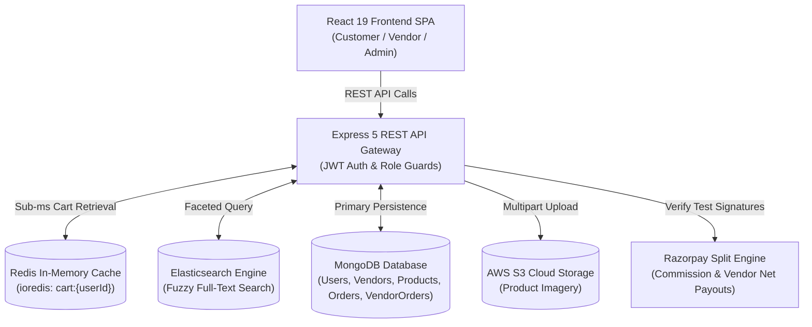

# Vendora – Scalable Multi-Vendor E-Commerce Marketplace

> *"One Marketplace. Multiple Sellers. Endless Possibilities."*

[](https://react.dev)
[](https://nodejs.org)
[](https://expressjs.com)
[](https://mongodb.com)
[](https://elastic.co)
[](https://redis.io)
[](https://aws.amazon.com/s3/)
[](https://razorpay.com)

**Vendora** is an enterprise-grade, full-stack multi-vendor e-commerce platform connecting shoppers, independent merchants, and platform administrators. Built on a resilient MERN architecture, Vendora handles multi-tenant store operations, faceted full-text product search, sub-millisecond Redis cart caching, dynamic multi-vendor split sub-orders, automated commission deductions, and end-to-end fulfillment tracking.

---

## 📑 Table of Contents
1. [Tech Stack Overview](#-tech-stack-overview)
2. [Key System Features](#-key-system-features)
3. [Architecture & Multi-Vendor Order Flow](#-architecture--multi-vendor-order-flow)
4. [Quick Start & Setup Instructions](#-quick-start--setup-instructions)
5. [Demo Accounts & 1-Click Credentials](#-demo-accounts--1-click-credentials)
6. [Automated Testing & Benchmarks](#-automated-testing--benchmarks)
7. [Deliverables & Documentation Links](#-deliverables--documentation-links)

---

## 🛠 Tech Stack Overview

| Layer | Technology | Purpose & Implementation |
| :--- | :--- | :--- |
| **Frontend** | React 19, React Router v7, Bootstrap 5, Lucide Icons | Responsive SPA with dedicated Customer, Vendor, and Admin portals |
| **Backend** | Node.js v24, Express 5 REST API | Decoupled MVC architecture with stateless JWT security |
| **Database** | MongoDB Atlas & Mongoose ODM | Relational document modeling for all 15 core domain schemas |
| **Search Engine** | Elasticsearch (`@elastic/elasticsearch`) | Fuzzy full-text indexing, multi-field weighted boosts, faceted filters (MongoDB regex fallback) |
| **Cache Layer** | Redis (`ioredis`) | High-speed cart caching with automated TTL and fast retrieval (In-memory Map fallback) |
| **Media Storage**| AWS S3 (`@aws-sdk/client-s3`) & Multer | Multipart upload pipeline for high-resolution product photography (Local `/uploads` fallback) |
| **Payments** | Razorpay Test Gateway | Multi-vendor commission deduction and automated merchant split payouts |
| **Invoicing** | PDFKit | Real-time dynamic PDF tax invoice streaming and download |

---

## 🌟 Key System Features

### 🛍️ Customer Experience
- **Faceted Product Discovery**: Search with typo tolerance, filter by categories, price range, and sort by price, rating, or newest.
- **Dynamic Categories**: Browse products across curated categories (`/categories`) with live product counts.
- **High-Speed Cart**: Cart items synchronized instantly with Redis in-memory cache and persisted in MongoDB.
- **Wishlist Bookmarking**: Save favorite products to personal wishlist (`/wishlist`) and move to cart with 1 click.
- **Customer Address Book**: Manage multiple delivery addresses (`/profile`) with default shipping address selection.
- **Public Merchant Storefronts**: Dedicated storefront pages (`/store/:vendorId`) displaying merchant details, badges, and active listings.
- **Promotional Coupons**: Real-time discount validation (`WELCOME50`, `VENDORA10`, `FESTIVE20`).
- **Interactive Checkout**: Razorpay test payment integration with instant signature verification.
- **Order Lifecycle Tracking**: Live visual progress indicators (`Placed` $\rightarrow$ `Packed` $\rightarrow$ `Shipped` $\rightarrow$ `Delivered`) with self-service cancellation.
- **PDF Tax Invoices**: Download official tax invoices streamed dynamically from the server.
- **Verified Reviews**: 5-star rating system with verified purchaser badges.

### 🏪 Vendor Storefront & Fulfillment
- **Merchant Onboarding**: Application flow for store name, business description, contact phone, and warehouse address.
- **Catalog Management**: Add, edit, or delete product listings with pricing, SKU tracking, inventory counters, and multi-image galleries.
- **Cloud Media Uploads**: Multipart image uploads directly to AWS S3 (with local disk fallback).
- **Inventory Control**: Low-stock alerts ($\le 5$ items) and quick stock adjustments.
- **Independent Order Fulfillment**: Advance merchant sub-orders (`VendorOrder`) from `placed` to `packed`, `shipped`, and `delivered`.
- **Earnings Transparency**: Real-time breakdown of gross revenue, platform commission deductions, and net vendor earnings.
- **Store Customization**: Upload store logos, billboard banners, and maintain bank disbursement info.

### 🛡️ Super Admin Governance
- **Platform Analytics**: Real-time GMV, platform commission revenue, merchant payouts, and order breakdown.
- **Merchant Approval Workflow**: 1-click approval with customized commission rates or rejection with feedback.
- **User Account Management**: Search and toggle active status for customer and vendor accounts.
- **Product Moderation**: Review all listings across vendors, view stock, and toggle visibility.
- **Dynamic Category Manager**: Create, edit, and organize product categories with custom icons and banners.
- **Commission Ledger**: Comprehensive audit trail of all fees earned across vendor transactions.
- **Promotional Coupon Publisher**: Create custom discount codes with percentage cuts, caps, and expirations.

---

## 🏗 Architecture & Multi-Vendor Order Flow

Vendora features an enterprise-grade multi-vendor order split architecture:



### Multi-Vendor Split Processing
When a customer checks out a cart containing items from multiple vendors:
1. One parent customer `Order` is generated.
2. The order is split into isolated `VendorOrder` sub-orders for each merchant.
3. Platform commission is calculated per item based on each vendor's approved rate.
4. Stock is decremented atomically with overselling protection.
5. Vendors fulfill only their assigned items without access to other vendors' data.

---

## 🚀 Quick Start & Setup Instructions

### Prerequisites
- **Node.js** (v18 or higher) & **npm**
- **MongoDB** (Local instance or MongoDB Atlas cluster)

### 1. Clone the Repository
```bash
git clone https://github.com/AnujUttam/Vendora.git
cd Vendora
```

### 2. Configure Backend Environment
Navigate to `backend/` and verify `.env`:
```bash
cp .env.example .env
```
Key configuration parameters:
```env
PORT=5000
NODE_ENV=development
MONGO_URI=mongodb://localhost:27017/vendora
JWT_SECRET=super_secure_vendora_jwt_secret_key_2026
JWT_EXPIRE=7d
FRONTEND_URL=http://localhost:3000

# Cloud Integrations (Platform operates with local fallback if omitted)
REDIS_URL=redis://127.0.0.1:6379
ELASTICSEARCH_NODE=http://localhost:9200
AWS_REGION=us-east-1
AWS_BUCKET_NAME=vendora-marketplace-uploads
RAZORPAY_KEY_ID=rzp_test_placeholder_key
RAZORPAY_KEY_SECRET=rzp_test_placeholder_secret
```

### 3. Install Dependencies & Seed Sample Data
```bash
# In backend directory:
cd backend
npm install
node scripts/seedData.js
```

### 4. Start the Application
**Start Backend Server:**
```bash
cd backend
npm start
```
*Backend runs on `http://localhost:5000`*

**Start Frontend Application (in a separate terminal):**
```bash
cd frontend
npm start
```
*Frontend runs on `http://localhost:3000`*

---

## 🔑 Demo Accounts & 1-Click Credentials

For instant evaluation, the login page (`/login`) includes **1-Click Demo Login** buttons:

| Role | Email | Password | Access Level |
| :--- | :--- | :--- | :--- |
| **🛡️ Admin** | `admin@vendora.com` | `AdminPassword123!` | Full governance, commission config, vendor approvals |
| **🏪 Vendor 1** | `techhub@vendora.com` | `VendorPassword123!` | Approved merchant (TechHub Electronics, 10% commission) |
| **🏪 Vendor 2** | `urbanvogue@vendora.com` | `VendorPassword123!` | Approved merchant (Urban Vogue Lifestyle, 12% commission) |
| **🛍️ Customer** | `customer@vendora.com` | `CustomerPassword123!` | Verified shopper with active address and order history |

---

## 🧪 Automated Testing & Benchmarks

Run the comprehensive automated test suite verifying all 21 API endpoints, authorization boundaries, split payment math, and lifecycle state machines:

```bash
cd backend
node tests/api.test.js
```

### Test Suite Execution Output
```text
==================================================
  Running Vendora Comprehensive API Test Suite    
==================================================
  ✓ PASS: GET / returns 200 with Marketplace API metadata
  ✓ PASS: GET /api/health reports healthy system and fallback states
  ✓ PASS: POST /api/auth/register fails with 400 when missing credentials
  ✓ PASS: POST /api/auth/register validates minimum password length
  ✓ PASS: POST /api/auth/login fails with 400 on empty credentials
  ✓ PASS: GET /api/auth/me returns 401 without Bearer token
  ✓ PASS: GET /api/cart returns 401 without Bearer token
  ✓ PASS: POST /api/orders/checkout returns 401 without Bearer token
  ✓ PASS: GET /api/admin/analytics returns 401 without Admin privileges
  ✓ PASS: GET /api/wishlist returns 401 without Bearer token
  ✓ PASS: GET /api/auth/addresses returns 401 without Bearer token
  ✓ PASS: GET /api/notifications returns 401 without Bearer token
  ✓ PASS: GET /api/payments/my-payments returns 401 without Bearer token
  ✓ PASS: GET /api/vendor/profile returns 401 without Bearer token
  ✓ PASS: POST /api/categories returns 401 without Admin privileges
  ✓ PASS: GET /api/categories returns 200 and categories array
  ✓ PASS: GET /api/vendor/store/:id returns 404 for invalid vendor id
  ✓ PASS: POST /api/payments/webhook returns 400 when signature missing
  ✓ PASS: Commission engine accurately calculates vendor payouts and platform fee
  ✓ PASS: Razorpay test verification accepts simulated test signatures
  ✓ PASS: GET /api/unknown-endpoint returns 404 response
==================================================
Test Execution Finished: 21 passed, 0 failed
==================================================
```

---

## 📋 Deliverables & Documentation Links

Complete architectural blueprints and references:
- 📑 [Development Plan](DEVELOPMENT_PLAN.md) – Project audit, gaps analysis, and 8-phase execution plan.
- 📡 [API Documentation](API_DOCUMENTATION.md) – Exhaustive reference of all REST routes, schemas, and payloads.
- 🗄️ [Database Schema Reference](DATABASE_SCHEMA.md) – Entity Relationship Diagram and definitions for all 15 Mongoose schemas.
- 🏗️ [Technical Architecture](ARCHITECTURE.md) – High-level architecture, multi-vendor order split logic, and fallback designs.
- ⚙️ [Environment Template](backend/.env.example) – Complete configuration reference.
