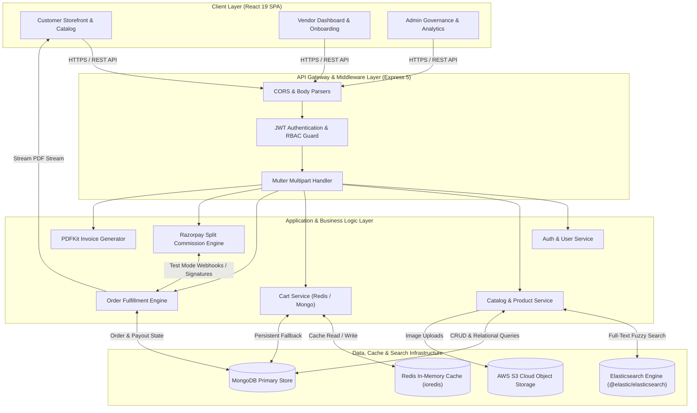
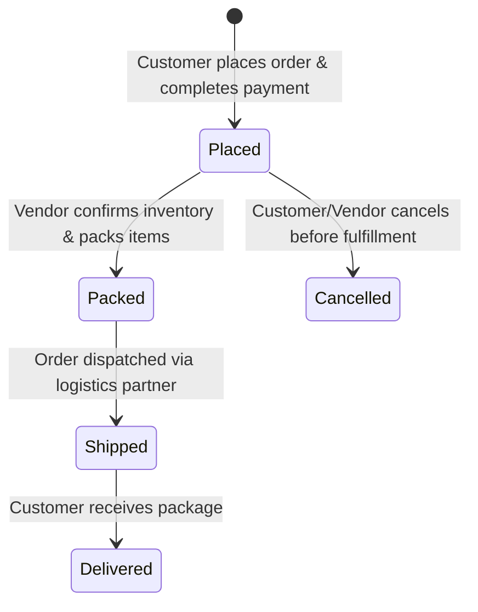

# Vendora - System Architecture & Engineering Design

## 1. Executive Summary
**Vendora** is a high-performance, resilient multi-vendor e-commerce marketplace platform built with the MERN stack (MongoDB, Express, React, Node.js), augmented with **Elasticsearch** for fuzzy full-text search, **Redis** for sub-millisecond cart caching, **AWS S3** for media storage, and **Razorpay** for automated split payments and commission disbursements.

The system enforces strict role-based access control (RBAC) across three distinct actors:
- **Customers**: Browse, filter, search, add to cart (cached in Redis), checkout with test mode payment gateway, track real-time order lifecycle, download PDF tax invoices, and write verified reviews.
- **Vendors**: Apply for merchant onboarding, manage catalog listings, upload multi-part product imagery to S3, track sales, manage fulfillment lifecycles (`placed` -> `packed` -> `shipped` -> `delivered`), and view net payouts.
- **Admins**: Approve or reject vendor applications, configure commission rates, publish promotional coupons, oversee all marketplace transactions, and analyze platform GMV and revenue metrics.

---

## 2. High-Level Architecture Diagram

---

## 3. Component Details & Technology Choices

### 3.1 Frontend: React 19 SPA
- **Component Architecture**: Modular page and component hierarchy organized by route and functional domain.
- **State Management**:
  - `AuthContext`: Centralized JWT authentication token lifecycle, persistent session synchronization via `localStorage`, and active role authorization.
  - `CartContext`: High-speed cart operations, instantaneous local state updates, coupon application, and total recalculation.
- **Design System**: Responsive mobile-first interface built on Bootstrap 5 and customized Lucide-React icons.

### 3.2 Backend: Node.js & Express 5
- **Modular REST Design**: Decoupled MVC structure (Models, Controllers, Services, Middleware, Routes).
- **Authentication**: Stateless JSON Web Tokens (JWT) signed with HMAC SHA-256 and verified per request.
- **Security**: Passwords salted and hashed with `bcryptjs` (cost factor 12). Express security headers and sanitized MongoDB queries.

### 3.3 Redis Caching Architecture
- **Cache-Aside Pattern**: Shopping carts are cached under `cart:{userId}` with a 7-day TTL.
- **Sub-Millisecond Retrieval**: Cart fetches hit Redis first; upon cache miss, data is read from MongoDB and written back to Redis.
- **Resilient Fallback**: In the absence of a live Redis instance, the backend automatically transitions to an in-memory Map store with TTL invalidation, ensuring uninterrupted marketplace operations.

### 3.4 Elasticsearch Dual-Engine Search
- **Search Engine**: Index `vendora_products` with multi-match boosts on `name` (3x), `brand` (2x), `category`, and `description`.
- **Faceted Filters & Sorting**: Supports category term filters, price range queries, and sort criteria (Price Low/High, Rating, Newest).
- **Dual-Engine Graceful Fallback**: If Elasticsearch is unreachable, queries execute against MongoDB's regex and aggregate pipeline without raising user-facing errors.

### 3.5 AWS S3 Media Storage
- **Object Storage**: S3 bucket integration via `@aws-sdk/client-s3`.
- **Multipart Upload**: `multer.memoryStorage()` buffers incoming images and streams them with unique timestamp keys to S3.
- **Local Fallback**: If AWS credentials are not configured, files are securely stored on local disk under `/uploads` and served statically.

### 3.6 Split Payments & Commission Model
- **Razorpay Test Integration**: Computes multi-vendor splits during checkout.
- **Commission Equation**:
  $$\text{Commission} = \frac{\text{Item Total} \times \text{Vendor Commission Rate}}{100}$$
  $$\text{Vendor Payout} = \text{Item Total} - \text{Commission}$$
- Stores line-item vendor breakdowns so orders with items from multiple distinct merchants disburse exact net payouts to each seller.

### 3.7 Order Fulfillment State Machine

---

## 4. Scalability & Deployment Architecture
- **Separation of Concerns**: Frontend and Backend deploy independently.
- **Frontend Deployment**: Static hosting on Vercel, Netlify, or AWS CloudFront/S3.
- **Backend Deployment**: Containerized Node.js service on AWS ECS / Render / Railway.
- **Database Clustering**: MongoDB Atlas with replica sets, Redis Cloud cluster, and managed Elasticsearch.
