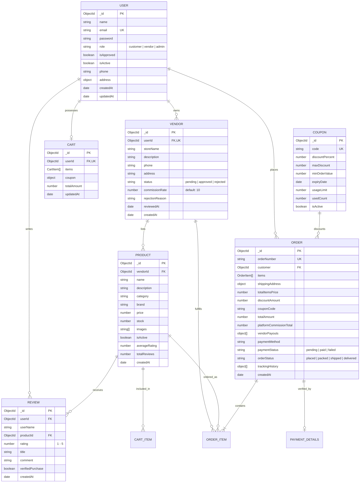

# Vendora - Database Architecture & Schema Specification

## 1. Overview
Vendora utilizes **MongoDB** as its primary document store, engineered for high concurrency, horizontal scalability, and flexible document modeling suitable for multi-vendor e-commerce.

---

## 2. Entity-Relationship (ER) Diagram

---

## 3. Detailed Collection Specifications

### 3.1 Users (`users`)
| Field | Type | Required | Constraints / Description |
| :--- | :--- | :--- | :--- |
| `_id` | ObjectId | Yes | Unique Primary Key |
| `name` | String | Yes | Trimmed, 2-100 characters |
| `email` | String | Yes | Unique index, normalized lowercase |
| `password` | String | Yes | Bcrypt hash with salt rounds = 12 (min length 8) |
| `role` | String | Yes | Enum: `['customer', 'vendor', 'admin']` (default: `'customer'`) |
| `isApproved` | Boolean | Yes | Merchant selling permission (default: `false` for vendors) |
| `isActive` | Boolean | Yes | Account status toggle for administrative lockouts |
| `phone` | String | No | Contact telephone |
| `address` | Object | No | `{ street, city, state, postalCode, country }` |

### 3.2 Vendors (`vendors`)
| Field | Type | Required | Description |
| :--- | :--- | :--- | :--- |
| `_id` | ObjectId | Yes | Primary Key |
| `userId` | ObjectId | Yes | Reference to User (`users._id`), Unique Index |
| `storeName` | String | Yes | Public store branding |
| `description` | String | Yes | Overview of business / catalog |
| `phone` | String | Yes | Business telephone |
| `address` | String | Yes | Registered physical / warehouse address |
| `status` | String | Yes | Enum: `['pending', 'approved', 'rejected']` |
| `commissionRate`| Number | Yes | Platform fee percentage (default: `10%`) |
| `rejectionReason`| String | No | Feedback if rejected by Admin |
| `reviewedAt` | Date | No | Timestamp of admin decision |

### 3.3 Products (`products`)
| Field | Type | Required | Description |
| :--- | :--- | :--- | :--- |
| `_id` | ObjectId | Yes | Primary Key |
| `vendorId` | ObjectId | Yes | Reference to Vendor (`vendors._id`), Indexed |
| `name` | String | Yes | Product headline (3-150 chars) |
| `description` | String | Yes | Markdown or text description |
| `category` | String | Yes | Categorization index |
| `brand` | String | No | Manufacturer / Brand |
| `price` | Number | Yes | Positive numeric value in INR |
| `stock` | Number | Yes | Non-negative integer inventory counter |
| `images` | [String]| No | Array of S3 URLs or local uploaded asset paths |
| `isActive` | Boolean | Yes | Marketplace visibility status (default: `true`) |
| `averageRating`| Number | Yes | Computed rating average (0 - 5) |
| `totalReviews` | Number | Yes | Count of verified reviews |

### 3.4 Cart (`carts`)
- Synchronized dual-state: In-memory **Redis Cache** (`cart:{userId}`) with asynchronous backup to MongoDB.
- Contains nested items: `{ product, name, price, image, vendorId, quantity }`.
- Holds active promo coupon discount calculation.

### 3.5 Orders (`orders`)
- Represents multi-vendor transactional purchases.
- **`items`**: Array of sub-items tagged with individual `vendorId`, item-level `commissionRate`, `commissionAmount`, and `vendorPayout`.
- **`vendorPayouts`**: Aggregated disbursement schedule grouped by distinct merchant.
- **`trackingHistory`**: Audit log of fulfillment transitions (`status`, `note`, `updatedBy`, `timestamp`).

### 3.6 Reviews (`reviews`)
- Customer ratings (1-5 stars) and comments.
- Flag `verifiedPurchase: true` automatically validated against customer order history.

### 3.7 Coupons (`coupons`)
- Promotional promo codes with percentage discounts, maximum rupee caps, minimum cart value criteria, and expiration dates.
